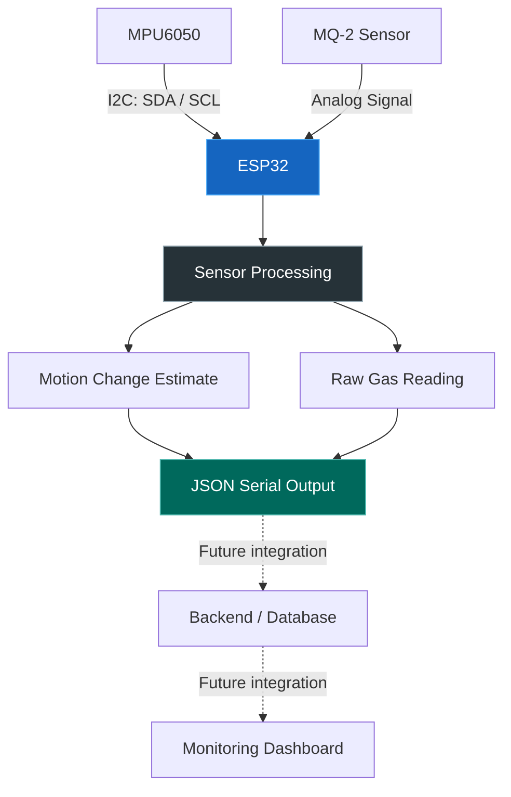

# ⚡ AI SENSOR HOUSE

### 🏠 Turning a house into a live sensor-driven system.

<p align="center">
  
  
  
  
</p>

<p align="center">
  <b>Embedded Systems × Sensor Technology × Smart Infrastructure</b>
</p>

---

## 🧠 THE VISION

What if a house could sense changes in its surroundings instead of simply being a physical structure?

**AI Sensor House** is a sensor-based smart-house prototype built around the ESP32 microcontroller. The project explores how physical sensor readings can be collected, processed, and eventually connected to a digital monitoring system.

The current prototype combines motion-related measurements from an **MPU6050 accelerometer/gyroscope** with analog readings from an **MQ-2 gas sensor**. The goal is to build a foundation for a connected house-monitoring system that brings embedded hardware and software together.

> **The mission:** Make the physical world measurable, the data understandable, and the system ready to grow.

## ⚙️ WHAT'S UNDER THE HOOD?

| Component | Role |
|---|---|
| 🧠 ESP32 DevKit V1 | Main microcontroller |
| 📐 MPU6050 | Accelerometer and gyroscope measurements |
| 🌫️ MQ-2 | Analog gas/smoke sensor readings |
| 🔌 I²C | Communication between the ESP32 and MPU6050 |
| 🧪 Wokwi | Virtual circuit simulation |
| 🛠️ PlatformIO | Embedded development and build environment |
| 💻 C++ | Sensor acquisition and processing logic |

## 🚀 CURRENT CAPABILITIES

### 01 — Motion Sensing
The MPU6050 provides three-axis acceleration readings. The firmware calculates the acceleration magnitude and compares consecutive measurements to estimate changes in motion.

### 02 — Gas Sensor Readings
The MQ-2's analog output is sampled through an ESP32 ADC input. The resulting value provides a raw sensor reading that can be used as a starting point for later calibration.

**Important:** Raw ADC values are not gas concentrations in ppm. Reliable concentration estimates require suitable calibration and sensor-specific testing.

### 03 — Structured Serial Output
Sensor measurements are printed as JSON-formatted records over the serial monitor, making the data easier to inspect and potentially consume in a future software pipeline.

Example output:

```json
{
  "gas_level": 45,
  "accel_magnitude": 9.81,
  "accel_change": 0.12,
  "motion": false
}
```

*Illustrative sample only. Actual values depend on the simulation, sensor readings, and motion threshold.*

### 04 — Simulation-First Development
The firmware can be developed and tested in Wokwi before moving to physical hardware. PlatformIO provides a consistent project structure and build workflow.

## 🏗️ SYSTEM ARCHITECTURE



The current firmware covers sensor acquisition, basic processing, and serial output. Backend ingestion, database updates, and dashboard integration are **future integration stages**, not capabilities claimed as complete by this repository.

## 🔌 CONNECTION MAP

### MPU6050 → ESP32

| MPU6050 Pin | ESP32 Pin |
|---|---|
| VCC | 3V3 |
| GND | GND |
| SDA | GPIO 21 |
| SCL | GPIO 22 |

### MQ-2 → ESP32

| MQ-2 Pin | ESP32 Pin |
|---|---|
| VCC | VIN / 5V supply |
| GND | GND |
| AO | GPIO 34 |
| DO | Not connected |

> ⚠️ **Hardware safety:** ESP32 GPIOs are not 5 V tolerant. Ensure the MQ-2 analog output stays within the ESP32 ADC input range; use an appropriate voltage divider or signal-conditioning circuit when required. Check the actual module's output voltage before connecting it.

## 💻 GETTING STARTED

### Prerequisites

- [Visual Studio Code](https://code.visualstudio.com/)
- [PlatformIO IDE](https://platformio.org/install/ide?install=vscode)
- [Wokwi for VS Code](https://docs.wokwi.com/vscode/getting-started) or the online Wokwi simulator
- Basic familiarity with ESP32 wiring and serial monitoring

### 1. Clone the repository

```bash
git clone https://github.com/Moksh-dev/AI-Sensor-House.git
cd AI-Sensor-House
```

### 2. Open the project

Open the cloned folder in VS Code and allow PlatformIO to initialize the project.

### 3. Build the firmware

Open the PlatformIO terminal and run:

```bash
pio run
```

A successful build confirms that the firmware compiles for the configured ESP32 environment.

### 4. Run the simulation

Open the circuit in Wokwi, start the simulation, and inspect the serial output at **115200 baud**.

If you're using the local PlatformIO build with Wokwi, check that the firmware paths in `wokwi.toml` match the generated build files.

## 📁 PROJECT STRUCTURE

```text
AI-Sensor-House/
├── .vscode/          # Editor configuration
├── include/          # Project header files
├── lib/              # Project-local libraries
├── src/
│   └── main.cpp      # Sensor acquisition and processing
├── test/             # Test directory
├── diagram.json      # Wokwi circuit definition
├── platformio.ini    # PlatformIO configuration
├── wokwi.toml        # Wokwi firmware configuration
└── README.md         # Project documentation
```

## 🗺️ ROADMAP

- [x] ESP32 development environment setup
- [x] Wokwi-based sensor simulation
- [x] MPU6050 initialization and acceleration readings
- [x] MQ-2 analog input acquisition
- [x] Basic motion-change calculation
- [x] Structured serial data output
- [ ] Calibrate and validate sensor thresholds
- [ ] Validate readings on physical hardware
- [ ] Confirm backend data-ingestion API
- [ ] Integrate sensor data with the backend and database
- [ ] Connect a digital monitoring dashboard
- [ ] Evaluate additional sensing capabilities

*Roadmap status reflects the current prototype; items should be checked off only after they are implemented and tested.*

## 🔭 WHAT COMES NEXT?

The long-term direction is to connect the sensor layer to a complete digital monitoring workflow:

**Sense → Process → Transmit → Store → Visualize**

That means moving beyond isolated sensor readings toward a system where data can be collected, stored, and explored through a central interface.

The next major milestone is validating the sensor measurements and confirming the backend's ingestion interface before attempting end-to-end integration.

## 🧪 ENGINEERING NOTES

- The current motion indicator uses a simple acceleration-magnitude-change threshold. It is a prototype heuristic, not a validated vibration classifier.
- The MQ-2 output is treated as a raw ADC reading. No calibrated gas concentration is currently calculated.
- Simulation results do not replace testing with real hardware.
- Network connectivity and backend communication must be implemented and verified separately.

## 🤝 CONTRIBUTING

Ideas, improvements, and constructive feedback are welcome.

If you want to contribute:

1. Fork the repository.
2. Create a branch for your changes.
3. Make and test your changes.
4. Open a pull request describing what changed and why.

Keep changes focused, document new sensor connections, and include enough information to reproduce your results.

## 👨‍💻 PROJECT

**Repository:** [Moksh-dev/AI-Sensor-House](https://github.com/Moksh-dev/AI-Sensor-House)

Built as a hands-on exploration of embedded systems, sensor integration, and smart-house simulation.

---

<p align="center">
  <b>⚡ Small sensors. Real data. Bigger possibilities.</b>
</p>

<p align="center">
  <i>AI Sensor House — building the bridge between physical systems and digital intelligence.</i>
</p>